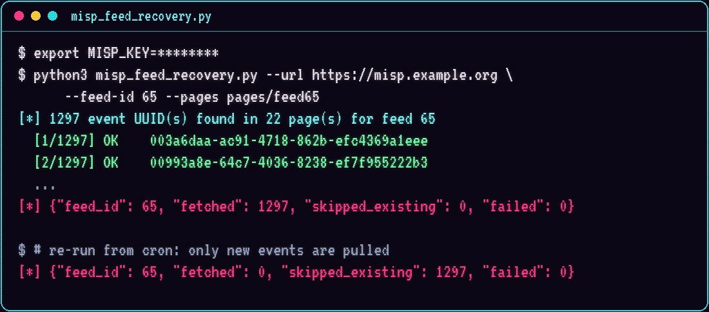

<p align="center"></p>

# MISP Feed Event Recovery

Some MISP feeds are too slow or too large to fetch reliably. In production I saw large abuse.ch feeds (MalwareBazaar, URLhaus) time out or stall partway through a full **Fetch all events**, which left the instance with gaps in its threat intel.

This tool works around it. It collects the event UUIDs listed on the feed's preview pages, then asks MISP to pull **each event individually**, using the same endpoint as the per-event *Fetch* button in the feed preview (`/feeds/getEvent/<feed_id>/<uuid>`). Small requests finish; one giant request doesn't.

<p align="center"></p>

## Quick start

```bash
git clone https://github.com/64BitZayn/misp-feed-event-recovery.git
cd misp-feed-event-recovery
pip install -r requirements.txt

export MISP_KEY=your_api_key   # never hard-code it
python3 misp_feed_recovery.py --url https://misp.example.org --feed-id 65 --pages pages/feed65
```

**Getting the pages:** in MISP, open **Sync Actions → Feeds**, click the magnifier on the feed to open its preview, and save each page as HTML into one folder. To see what would be fetched without touching MISP, run with `--dry-run`.

## Options

| Option | Default | Purpose |
| --- | --- | --- |
| `--url` | required | MISP base URL |
| `--feed-id` | required | Numeric feed ID |
| `--pages` | required | Folder of saved preview pages |
| `--key` | `$MISP_KEY` | API key |
| `--out` | `fetched_events/` | One JSON response per event |
| `--retries` | `3` | Retries per event, with exponential back-off |
| `--timeout` | `120` | Seconds per request |
| `--insecure` | off | Skip TLS verification (self-signed lab certs only) |
| `--dry-run` | off | List the UUIDs only |

The tool exits with code `1` if any event failed, so cron or monitoring can flag it.

## Running it on a schedule

Already-fetched events are skipped, so re-runs resume where the last one stopped and only pull what's new. See [`examples/crontab.example`](examples/crontab.example) for a 6-hourly schedule.

## Things I learned along the way

- **Preview pages differ between versions and users.** Some list events as *Fetch* forms, others only as *preview* links. My first version only read the forms and silently found **zero** events on one feed. The tool now reads both.
- **Freetext and CSV feeds have no events to recover.** Feeds like plain URL or IP lists are parsed into attributes rather than published as MISP events, so this approach only applies to feeds in **MISP format**.
- **Caching isn't fetching.** *Caching* a feed loads it into Redis for correlation ("feed hits") but creates no events. That means integrations that query MISP's database (Wazuh, for example) never see cached data. If downstream tools need the IOCs, the feed has to be fetched.
- **Delta merge keeps it lean.** For feeds that republish full lists, enabling *delta merge* keeps only the latest pull instead of piling up old copies.

[`examples/feed-catalog.csv`](examples/feed-catalog.csv) lists common public MISP feeds and the indicator types each provides. It's handy when choosing which feeds to enable and which downstream rules they can feed.

## Testing

Verified against a mock MISP server using real saved preview pages: 1,297 event UUIDs found for MalwareBazaar and 1,283 for URLhaus. Transient HTTP 500s recovered through retries, re-runs skipped everything already fetched, and a wrong API key made every request fail with exit code 1.

## License

[MIT](LICENSE)
